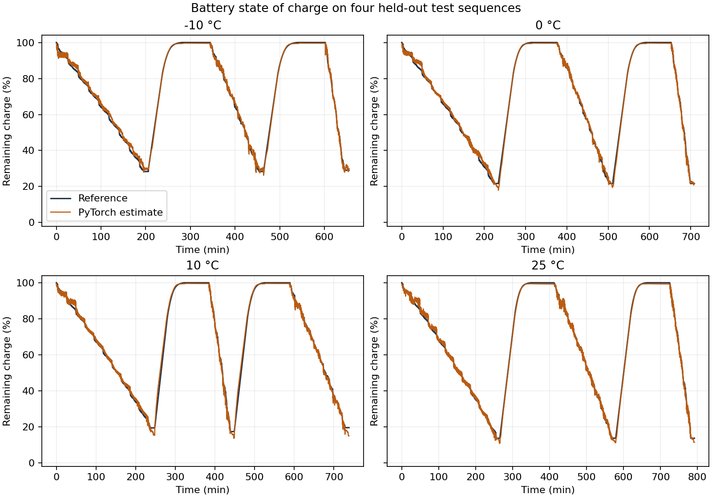

# Battery State of Charge Estimation with PyTorch

Estimate how much charge an LG 18650HG2 lithium-ion cell has left from voltage, current, temperature, and the moving averages of voltage and current. This PyTorch reproduction uses the prepared data from [Kollmeyer et al. at McMaster University](https://data.mendeley.com/datasets/cp3473x7xv/3) (CC BY 4.0).

## Run locally

Download and extract the prepared dataset. Set `--data-dir` to the `LGHG2@n10C_to_25degC` folder containing `Other_Files` and `Test`. The script reads the prepared `.mat` files in place.

```sh
python -m venv .venv
source .venv/bin/activate
python -m pip install -r requirements.txt
python train.py --data-dir "/path/to/LGHG2@n10C_to_25degC"
```

The default CPU run trains for 35 epochs. Use `--epochs 3` for a quick check or `--output-dir` to keep multiple runs. The `results/` folder contains `model.pt`, `metrics.csv`, `soc_predictions.png`, and `training_loss.png`. The checkpoint includes the weights, feature order, and normalization statistics.

## How the evaluation works

For each temperature, the first 80% of the prepared training sequence fits the model and the last 20% selects the checkpoint. The feature mean and standard deviation are computed from the training partition and reused for validation and test. The final evaluation uses the four prepared test sequences at −10, 0, 10, and 25 °C. Those four sequences are evaluated after checkpoint selection.

This implementation uses training-only standardization, two 55-unit hidden layers, and a sigmoid output between 0 and 1. It trains with Adam, 4,096 observations per batch, and an exponentially decaying learning rate. RMSE and maximum absolute error are both reported in percentage points. A prediction of 48% against a reference of 50% has a 2 percentage-point absolute error. The data is from one battery cell, so the results characterize these test sequences.

## Verified run

The included results use Python 3.13, PyTorch 2.15.0, and seed 42 on CPU. The model trained on 535,962 observations, and epoch 35 had the lowest loss on the 133,994 validation observations. Reloading the saved checkpoint reproduces the four test results.

| Test temperature | Samples | RMSE (percentage points) | Maximum absolute error (percentage points) |
| --- | ---: | ---: | ---: |
| −10 °C | 39,293 | 1.34 | 6.73 |
| 0 °C | 42,530 | 1.31 | 5.09 |
| 10 °C | 44,284 | 1.61 | 7.04 |
| 25 °C | 47,517 | 1.15 | 5.73 |


